# 🎯 Skill-Gap & Job-Match Engine

> A proof of concept for the **Cynbit Technologies AI/ML Engineer Intern assessment**: an AI engine that connects learner resumes to career roles and to training modules.

**🔗 Live demo: https://cynbit-skill-gap-engine-ghyh4sg4klxn2vwx5bbbsx.streamlit.app/

---

## 📌 The Opportunity

Cynbit runs **BitElevate** (technical training) and **Cynbit Studio** (coding practice, AI code evaluation, career preparation and job matching). These two products serve the same learner journey, but nothing in their public descriptions suggests they feed each other.

This project explores one bridge between them: read a learner's resume, work out which skills they are missing for a target role, and recommend the training modules that close those gaps. A learner gets a clear next step, and Cynbit gets a natural path from job matching to training enrollment.

## ✨ Features

- **Resume parsing:** upload a PDF or TXT resume.
- **LLM skill extraction:** Gemini returns skills as structured JSON.
- **Skill normalization:** variants map to one name (for example `ReactJS`, `React.js` and `react` all become `react`).
- **Role matching:** compares the learner's skills against a target role and returns a match score, matched skills and gaps.
- **Module recommendation:** ranks catalog modules by how many gaps each one covers.
- **Learning plan:** an optional short, LLM-written plan based on the gaps and recommendations.
- **Human in the loop:** extracted skills appear in an editable box, so the user can correct the AI before the score is calculated.

## 🏗️ How it works

```mermaid
flowchart LR
    A[Resume PDF/TXT] --> B[Text extraction - pypdf]
    B --> C[Gemini: skills as JSON]
    C --> D[Normalize skills]
    D --> E[User review and edit]
    E --> F[Match against role skills]
    F --> G[Score and gaps]
    G --> H[Rank catalog modules]
    H --> I[Learning plan - Gemini]
```



| Step | What happens | Tool |
|------|--------------|------|
| 1 | Extract text from the resume | `pypdf` |
| 2 | Extract skills with a strict JSON prompt, temperature 0 | Gemini API |
| 3 | Normalize skill names with an alias map | Python |
| 4 | User confirms or edits the skills | Streamlit |
| 5 | Compute match score, matched skills and gaps | Python |
| 6 | Rank modules by number of gaps covered | Python |
| 7 | Generate a short learning plan | Gemini API |

## 🧰 Tech stack

- **Language:** Python
- **UI:** Streamlit
- **LLM:** Google Gemini API (`google-genai`)
- **Resume parsing:** pypdf
- **Config:** python-dotenv

## 📁 Project structure

```
cynbit-skill-gap-engine/
├── app.py              # Streamlit app: extraction, matching, recommendation
├── data/
│   ├── modules.json    # Sample training module catalog
│   └── roles.json      # Sample role-to-skills taxonomy
├── docs/               # Opportunity Report and Technical Approach Report
├── requirements.txt
└── README.md
```

## 🚀 Run locally

```bash
git clone https://github.com/2207-anu/cynbit-skill-gap-engine.git
cd cynbit-skill-gap-engine
python -m venv venv
venv\Scripts\activate          # Mac/Linux: source venv/bin/activate
pip install -r requirements.txt
```

Create a `.env` file in the project root:

```
GEMINI_API_KEY=your_key_here
```

Get a free key at [Google AI Studio](https://aistudio.google.com). To use a different model, add `GEMINI_MODEL=model-name` to `.env`.

Then start the app:

```bash
python -m streamlit run app.py
```

## ⚠️ Limitations (honest notes)

- `data/modules.json` and `data/roles.json` are **sample data written for this demo**. Cynbit's real course catalog and role definitions are not public, so these files are illustrative placeholders.
- Matching is **exact-match after normalization**. It will miss near-synonyms that are not in the alias map.
- Skill extraction depends on the resume text. Scanned or image-only PDFs are not supported (no OCR).
- LLM output can contain errors, which is why the user can review and edit the extracted skills.

## 🗺️ Roadmap

1. **Semantic matching:** use embeddings so related skills (for example `FastAPI` and `Flask`) get partial credit.
2. **Weighted skills:** mark role skills as required or nice-to-have.
3. **Real data:** replace the sample files with Cynbit's actual catalog and job listings.
4. **Cynbit Studio signals:** add coding-practice results as evidence of skill level, not just resume claims.
5. **Evaluation set:** build a labelled set of resumes to measure extraction precision and recall.
6. **Progress tracking:** re-score learners as they complete modules.
